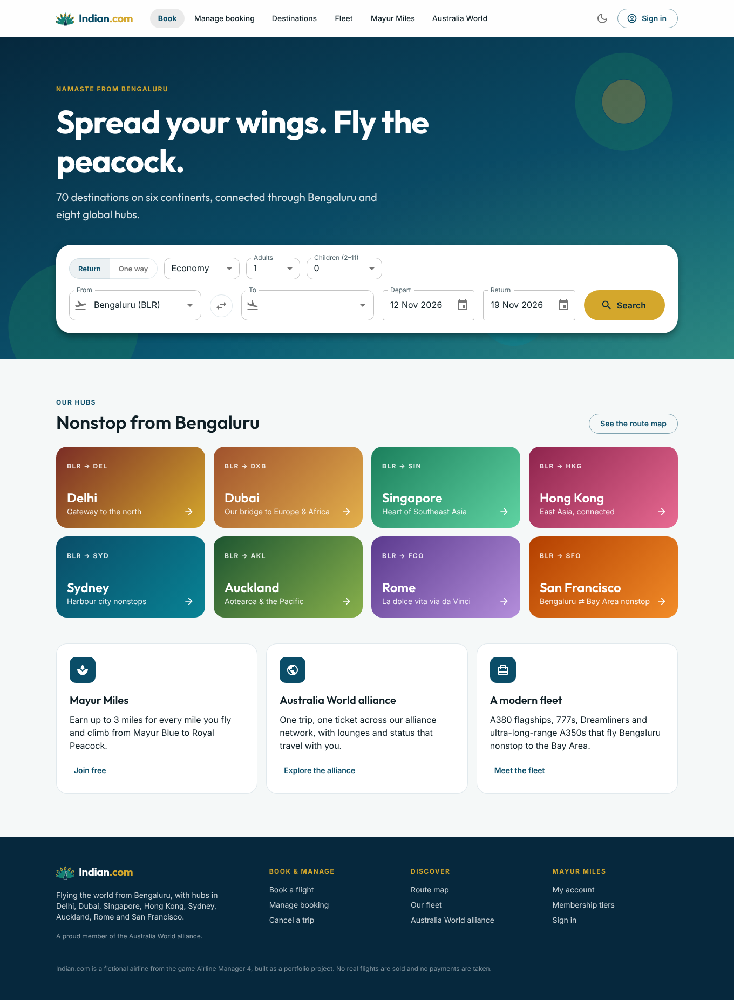
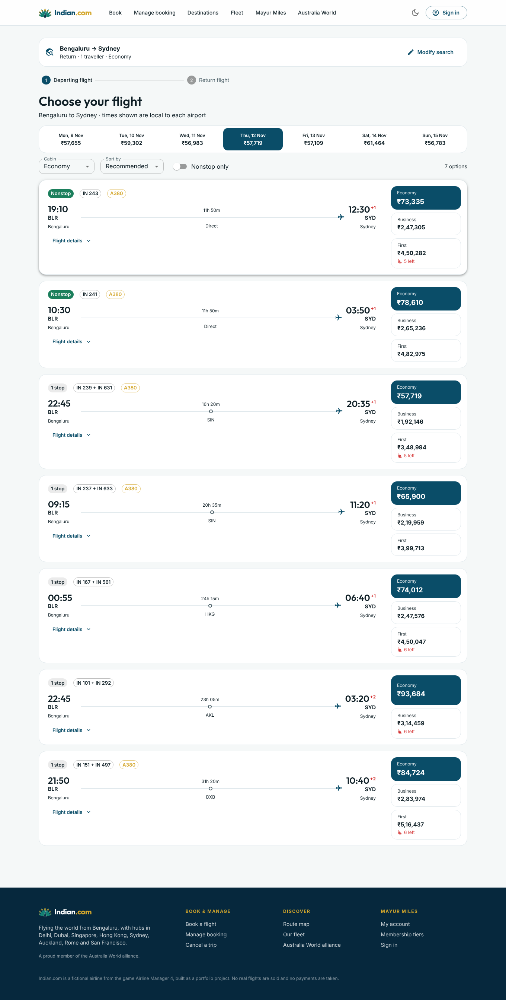
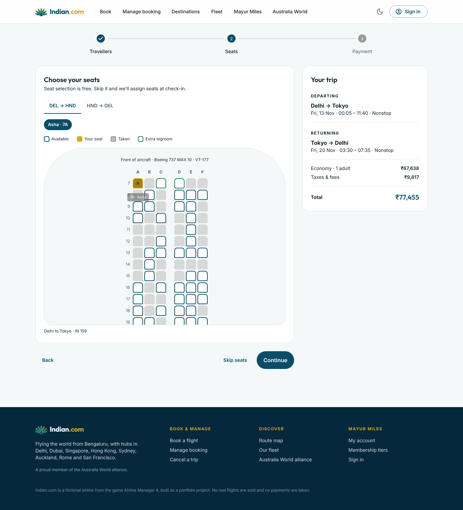
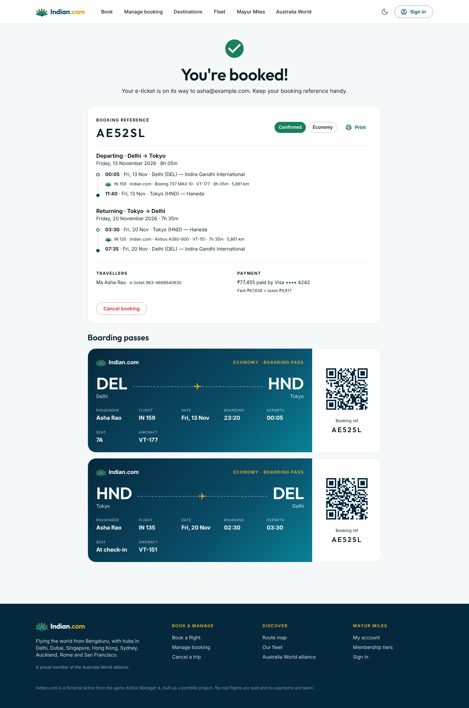
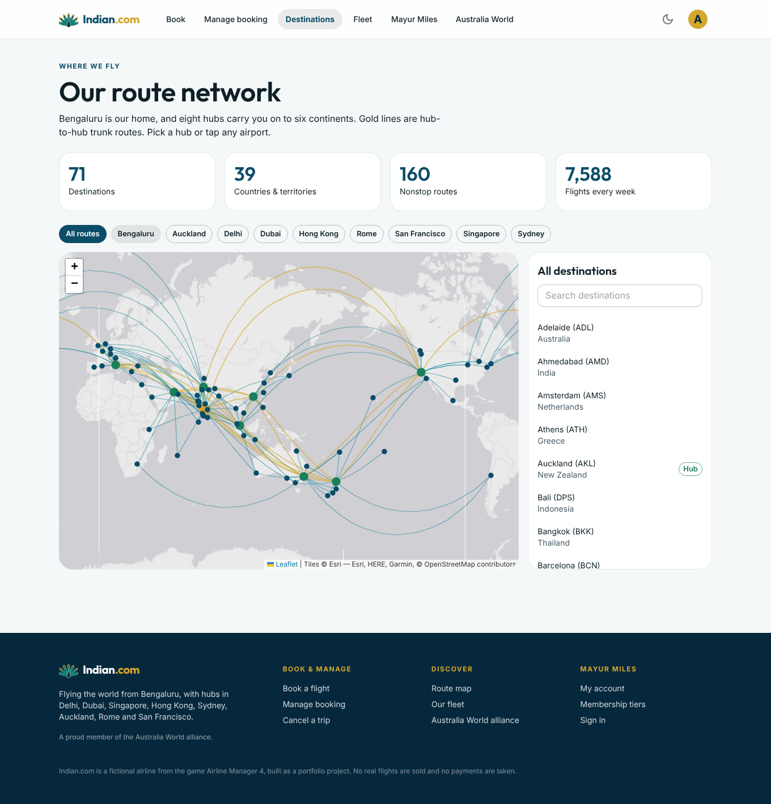
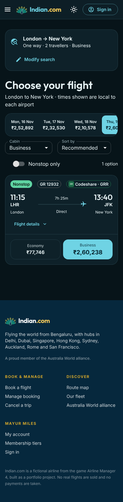
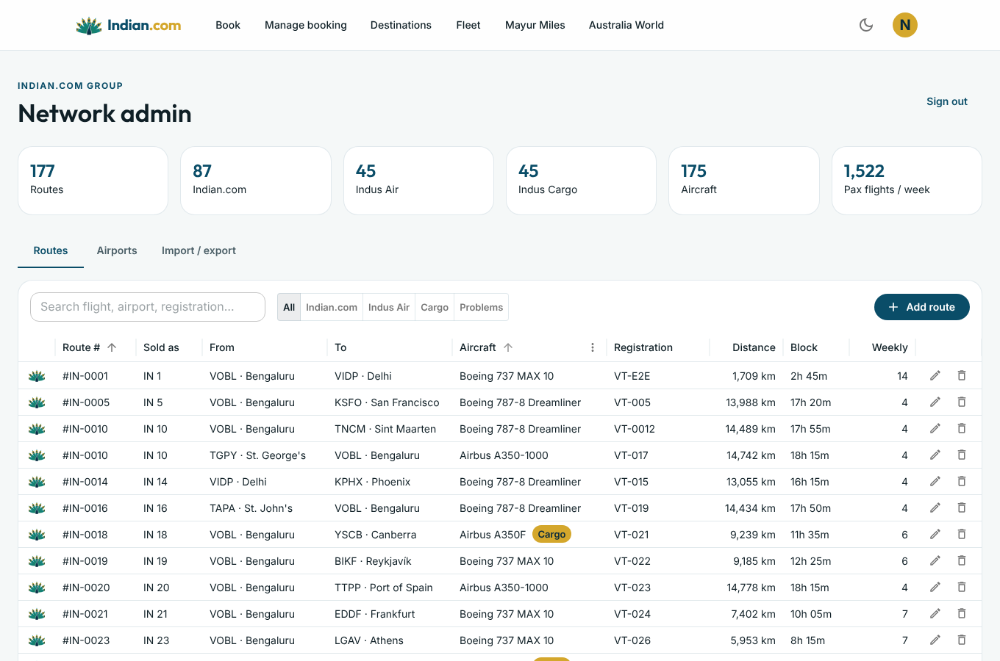
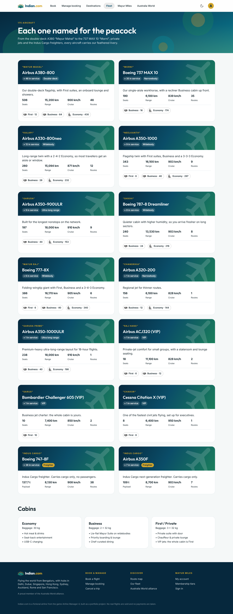

# Indian.com ✈️🦚

A flight-booking website for **Indian.com**, my airline in the game [Airline Manager 4](https://www.airlinemanager.com/), built as a portfolio project.

- **Brands:** **Indian.com** operates every route touching India. **Indus Air** is the global subsidiary flying everything else. **Indus Cargo** runs the freighters.
- **Primary hub:** Bengaluru (BLR)
- **Secondary hubs:** Delhi, Dubai, Singapore, Hong Kong, Sydney, Auckland, Rome Fiumicino (Leonardo da Vinci), San Francisco
- **Alliance:** Australia World, with partners Quantas, GRR and Ruby Air
- **Brand:** peacock (Mayur) mark in peacock blue, teal, emerald and gold

> Indian.com is fictional. No real flights are sold and no payments are taken.

## Screenshots

| Home | Results | Seats |
|---|---|---|
|  |  |  |
| **E-ticket** | **Route map** | **Mobile, dark (codeshare)** |
|  |  |  |
| **Admin** | **Fleet** | |
|  |  | |

## Features

| | |
|---|---|
| **Real AM4 network** | The 176 routes from my AM4 export (`backend/data/active_routes.csv`), each with its actual aircraft type and registration. One aircraft flies each route as a round trip, so frequency follows block time (a 17-hour 787 sector runs 4× a week; a short 737 hop runs twice daily). |
| **Any route** | Searches use our own network first: nonstop or up to 2 stops, with legal connection times. When we have nothing good that day, Australia World partners (Quantas, GRR, Ruby Air) step in with codeshares, either alone or feeding our flights at a hub. Every pair of the ~170 airports gets results. |
| **Flight search** | Fare calendar for ±3 days, cabin switch, sort and nonstop filter. Times are local to each airport. Results show the operating airline (Indian.com, Indus Air or a partner codeshare). |
| **Fares** | Economy, Business and First, priced by distance, demand, weekday and how far ahead you book. Children pay 75%. Connections get a discount. The server always recalculates the price. |
| **Seat maps** | A cabin layout for each type in the fleet: A380, 777-8X, A350-1000(ULR), A350-900ULR, A330-800neo, 787-8, 737 MAX 10, A320, plus private-cabin VIP jets (ACJ320, Challenger 605, Citation X). Freighters (747-8F, A350F) appear on the map but are never sold to passengers. A seat can never be sold twice: MongoDB enforces this with a unique index. |
| **Admin dashboard** | `/admin`: add, edit and delete routes. Shows operator, distance, block time and weekly frequency for each route. Add airports, import an AM4 CSV (merge or replace) and export the live network. Search updates immediately. |
| **Checkout** | Traveller details with passport-style validation, seat selection, and a demo card payment (Luhn check, expiry check, a test decline card). |
| **E-ticket** | Confirmation page with printable boarding passes and QR codes. |
| **Manage booking** | Look up a booking by reference + last name, view it or cancel it (cancelling frees the seats). |
| **Mayur Miles** | Earn 1×/2×/3× miles by cabin. Tiers run Mayur Blue → Silver → Gold → Royal Peacock. Dashboard shows upcoming and past trips. |
| **Route map** | Interactive Leaflet map with great-circle routes, coloured by Indian.com, Indus Air and Indus Cargo. Filter by hub, and list each airport's routes with flight number, aircraft and registration. |
| **Fleet & alliance** | Fleet page (each aircraft type has a peacock nickname) and an Australia World alliance page. |
| **UX** | Material Design 3–style MUI theme, light/dark mode, mobile-first layouts. Shows a "waking up the server" notice when the Render free tier is cold-starting. |

## Architecture

```
frontend/   Next.js 16 (App Router) + MUI 9 + SWR + Leaflet  → Vercel (or Netlify)
backend/    Node 20+ / Express 5 + MongoDB driver + Zod      → Render (free web service)
catalyst/   Zoho Catalyst function "auth_bridge"             → Zoho Catalyst (optional)
```

- **Routes** live in the database (seeded from the CSV on first boot), so admins can change them. **Schedules** are computed from the routes, not stored: any date resolves to concrete flights (e.g. `R135.o0_2026-11-13`; partner flights look like `P.LHR-JFK.0_2026-11-13`). The built network is cached and rebuilt after admin edits.
- **Storage:** MongoDB Atlas when `MONGODB_URI` is set. Without it, an in-memory store is used (fine for local dev and demos, but resets on restart).
- **Auth:** the API accepts HS256 JWTs from two issuers, the built-in demo login and the Catalyst `auth_bridge`. Both are signed with `AUTH_JWT_SECRET`. Guests can search, book and manage trips without signing in. Signed-in users earn miles and get a trips dashboard.

## Run locally

Requires Node 20+.

```bash
cd backend && npm install && npm run dev
```

```bash
cd frontend && npm install && npm run dev
```

Open http://localhost:3000. The API runs on :4000. Use test card `4242 4242 4242 4242`, any future expiry and any CVC.
The admin dashboard is at http://localhost:3000/admin. The local password is `admin`; set `ADMIN_PASSWORD` to change it.

Backend tests (search, connections, booking, seat conflicts, lookup, cancellation, miles):

```bash
cd backend && npm test
```

## Deploy (all free tiers)

1. **MongoDB Atlas:** create a free M0 cluster and a database user. Allow network access from anywhere (Render's IPs aren't fixed). Copy the connection string.
2. **Render (API):** New → Blueprint → select this repo (it uses `render.yaml`). Set `MONGODB_URI`, `CORS_ORIGINS` and `ADMIN_PASSWORD`. `CORS_ORIGINS` is your frontend URL, e.g. `https://my-app.vercel.app`; add `https://my-app-*.vercel.app` to allow Vercel preview deployments too. `AUTH_JWT_SECRET` is generated for you.
3. **Vercel (frontend):** import the repo with **Root Directory** set to `frontend`. Set `NEXT_PUBLIC_API_URL` to your Render URL (e.g. `https://indian-com-api.onrender.com`) for **both Production and Preview**. The value is baked in at build time, so redeploy after changing it.
   Netlify works too: base directory `frontend`, with the Next.js runtime.
4. **Zoho Catalyst (optional sign-in):** see [`catalyst/README.md`](catalyst/README.md). Once deployed, set `NEXT_PUBLIC_CATALYST_APP_URL` on Vercel, and optionally `DEMO_AUTH=false` on Render.

Render's free tier sleeps after ~15 minutes idle, so the first request can take up to a minute. The site shows a notice while it waits.

## API

| Method | Path | |
|---|---|---|
| GET | `/api/airports`, `/api/network`, `/api/fleet`, `/api/loyalty/tiers` | Catalogue |
| GET | `/api/flights/search?from&to&date&adults&children` | Itineraries with per-cabin prices and seats left |
| GET | `/api/flights/:legKey/seats?cabin=` | Seat map |
| POST | `/api/bookings` | Create a booking (validated, re-priced on the server, seats claimed atomically) |
| GET | `/api/bookings/:pnr?lastName=` | Look up a booking |
| POST | `/api/bookings/:pnr/cancel` | Cancel a booking (`{ lastName }`) |
| POST | `/api/auth/demo-login` | Demo sign-in (`{ name, email }` → JWT) |
| GET | `/api/me` | Profile, miles, tier and trips (requires sign-in) |
| POST | `/api/admin/login` | Admin password → admin token |
| GET/POST/PUT/DELETE | `/api/admin/routes[/:id]` | Manage routes (admin) |
| POST | `/api/admin/routes/import` · GET `/api/admin/routes/export.csv` | AM4 CSV import / export (admin) |
| GET/POST/DELETE | `/api/admin/airports[/:icao]` | Manage airports (admin) |
